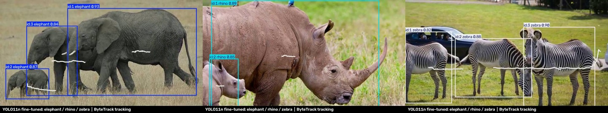

# YOLO11n Fine-tuning: elephant / rhino / zebra (3개 부류)

COCO로 사전학습된 **YOLO11n**을 코끼리(elephant)·코뿔소(rhino)·얼룩말(zebra) 3개 부류 데이터로 전이학습(fine-tuning)하고,
학습된 모델로 객체 감지 + 추적(ByteTrack) 동영상을 만든 머신러닝 과제 결과입니다.



## 결과 요약

| 세트 | Precision | Recall | mAP50 | mAP50-95 |
| --- | --- | --- | --- | --- |
| 검증(val, 163장) | 0.934 | 0.872 | 0.934 | 0.761 |
| 테스트(test, 178장) | 0.974 | 0.914 | 0.969 | 0.791 |

| 부류 (테스트) | Precision | Recall | mAP50 | mAP50-95 |
| --- | --- | --- | --- | --- |
| elephant | 0.967 | 0.900 | 0.958 | 0.754 |
| rhino | 0.998 | 0.960 | 0.989 | 0.877 |
| zebra | 0.958 | 0.881 | 0.960 | 0.740 |

- 추적 동영상: [`video/tracking_result.mp4`](video/tracking_result.mp4) (5초, 960×540, 30fps)
- 학습된 모델: [`weights/best.pt`](weights/best.pt) (5.5MB)
- 학습 곡선: [`results/results.png`](results/results.png), 테스트 PR 곡선·혼동행렬: `results/`

## 데이터셋

[Ultralytics African Wildlife](https://docs.ultralytics.com/datasets/detect/african-wildlife/) (4개 부류)에서
buffalo가 포함된 이미지를 빼고 3개 부류만 추출했습니다 (`scripts/make_dataset.py`).

| 분할 | elephant | rhino | zebra | 합계 |
| --- | --- | --- | --- | --- |
| train | 267 | 260 | 257 | 784 |
| val | 52 | 54 | 57 | 163 |
| test | 57 | 55 | 66 | 178 |

## 학습 설정

- 모델: `yolo11n.pt` (COCO 사전학습) → 탐지 헤드 출력 80 → 3 부류
- imgsz 416, batch 16, 최대 30 epoch (patience 10), AdamW lr0=0.002, cosine LR, warmup 3 epoch
- 증강: mosaic (마지막 10 epoch 끔), 좌우 반전, HSV, translate, scale
- 장치: CPU 2코어 (학습 시간 약 1.04시간), 전체 설정은 `results/args.yaml`

## 재현 방법

```bash
pip install -r requirements.txt

# 1) 데이터셋 준비 (african-wildlife.zip 압축을 푼 폴더 → 3개 부류 데이터셋)
curl -L -O https://github.com/ultralytics/assets/releases/download/v0.0.0/african-wildlife.zip
unzip african-wildlife.zip -d african-wildlife
python scripts/make_dataset.py african-wildlife datasets/wildlife3

# 2) 학습 (yolo11n.pt는 자동 다운로드)
python scripts/train.py 30 yolo11n_wildlife3

# 3) 평가 (val/test)
python scripts/evaluate.py weights/best.pt

# 4) 감지 + 추적 동영상 (원본 영상이 있으면 2번째 인자로 바로 사용)
python scripts/make_source_video.py video/source_5s.mp4 img1.jpg img2.jpg img3.jpg
python scripts/track_video.py weights/best.pt video/source_5s.mp4 video/tracking_result.mp4
```

## 추적 동영상 제작 방법

- 원본: 학습에 쓰지 않은 테스트 이미지 3장에 팬·줌 효과를 준 5초 합성 영상 (`video/source_5s.mp4`)
- `model.track(persist=True, tracker='bytetrack.yaml', conf=0.35)`로 프레임별 감지·추적
- ID별 상자 중심점을 저장해 최근 40프레임의 궤적(trajectory)을 그림
- 프레임 차이로 장면 전환을 감지해 추적기와 궤적을 초기화

## 파일 구성

```
├── data.yaml                 # 3개 부류 데이터셋 설정
├── requirements.txt
├── scripts/
│   ├── make_dataset.py       # 4개 부류 → 3개 부류 추출
│   ├── train.py              # fine-tuning
│   ├── evaluate.py           # val/test 평가
│   ├── make_source_video.py  # 테스트 이미지로 5초 원본 영상 합성
│   └── track_video.py        # 감지 + ByteTrack 추적 + 궤적 표시
├── weights/best.pt
├── results/                  # 학습 곡선, PR 곡선, 혼동행렬, metrics.json
└── video/                    # source_5s.mp4, tracking_result.mp4
```
